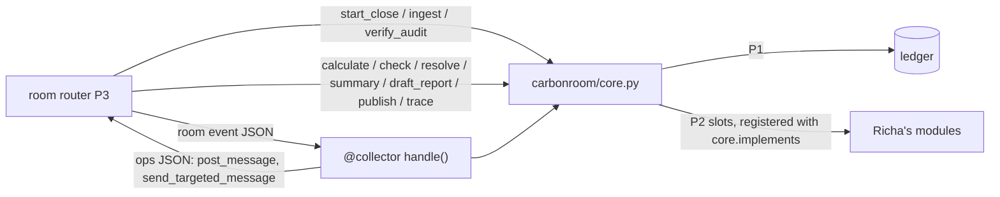

# Core API and the @collector agent

Owner: Ujjwal (P1). Code: `carbonroom/core.py`, `carbonroom/agents/collector.py`.

## Room-resume helpers

`carbonroom.core` exposes the small bridge used by the Switch orchestrator: `latest_close`, `resume_state`,
`gap_for_thread`, `record_gap_thread`, and `budget_usage`. They use the authoritative SQLite ledger; no room-side
cache is a source of truth. `ingest_file(close_id, path, actor, chat_message_id, site=None)` records the human
attachment message in the audit chain and returns only UNVERIFIED claim ids. The optional site is a
boundary-checked room hint, never an override of evidence extracted from the document.

## Why

The room (P3) needs one small, stable set of functions to call, so three people can build in parallel: the
architecture's "core API seam". And the close needs a `@collector` teammate in the room: it ingests every source,
then says what it collected. Its "all collected" statement is a claim for `@watchdog` to check, never a verdict,
and it never marks anything VERIFIED.

## Design



### Core API (`carbonroom.core`)

| Function | Owner | What it does here |
| --- | --- | --- |
| `start_close(month, sites, factor_set, actor, chat_message_id)` | P1 | opens `CLOSE-<month>-v<N>`, locks sites + factor set; returns the open close if there already is one |
| `ingest(close_id)` | P1 | `@collector` collects every source (`carbonroom.core.default_sources`, or `files=`) and returns the IngestReport |
| `verify_audit(close_id)` | P1 | walks the audit chain; `summary_text` is the room answer ("Audit chain intact: …") |
| `status(close_id)` | P1 | phase, claims by status, open gaps, missing evidence, which P2 functions are plugged in |
| `calculate`, `check`, `resolve`, `summary`, `draft_report`, `publish`, `trace` | P2 | phase bookkeeping here; the work in the function registered with `carbonroom.core.implements` |

- **P2 plugs in without editing this file.** Richa decorates her function with `@core.implements("calculate")` in
  one of the modules listed in `CORE_PLUGIN_MODULES` (core.py inside her calc, check or report package); core
  imports them on first use. Until then the call raises `NotImplementedError` naming the owner, so P3 can build
  against a fake core.
- **The phase lives in the ledger.** Each wrapper moves the close only when the move is allowed from where it is:
  `ingest` to COLLECTING, `calculate` to CALCULATING, `check` to CHECKING then AWAITING_HUMANS while gaps are
  open, `resolve` to RECHECKING (and back), `draft_report` to DRAFTED, `publish` through the ledger's publish
  gate. Repeating a step after a crash doesn't break anything.
- `resolve` and `publish` refuse without a `chat_message_id`; `publish` then calls
  `carbonroom.ledger.db.publish_close`, which also needs the publisher's APPROVE from the room.
- Every function takes `conn=` (an open ledger) or opens its own.

### @collector (`carbonroom.agents.collector`)

**Collect and report.** `carbonroom.agents.collector.collect` runs the background batch run over the sources,
with model calls charged to `cr-collector`'s budget for this close, then writes the IngestReport
(`cr.ingest-report.v1`) into the audit chain (`collection_reported`). The report lists every document in scope
(id + SHA-256), every claim in scope with its status, what this run added, what is outside the close (another month
or a site outside the boundary), what proved nothing, the expected sources still missing, a **statement** ("All
expected 2026-10 sources collected for 3 site(s)" or "1 expected 2026-10 source(s) still missing"), and the audit
head at that moment.

**Checked, never trusted.** `carbonroom.agents.collector.check_report` re-derives the report:

- every listed document is still in the ledger with that SHA-256, and its stored file still hashes to it
- every listed claim comes from a listed document, inside the month and boundary
- no claim that existed when the report was made is left out
- the missing list and the statement match the ledger as of the report
- `cr-collector` never set a status to VERIFIED
- the quoted audit head is in an intact chain

`@watchdog` (P2) or anyone can run it: `carbonroom collector check-report --close CLOSE-2026-10-v1`.

**"Why didn't you consider X?"** `carbonroom.agents.collector.explain` finds the documents a question names and
says what happened to each:

- when it arrived and from whom
- each claim and its status
- whether it was replaced, a byte-for-byte duplicate of another upload, outside this close, or proved nothing

If nothing by that name ever arrived, it says so, lists what it does have for that site, category or month, and
names what is still missing and who owns it. The answer is deterministic; the model may only reword it
(`CR_PHRASE`).

**Room contract.** The router (P3) turns a Switch event into
`{"type": "message" | "command", "message_id", "thread_id", "room", "sender", "text", "addressed",
"attachments": [{"name", "path"?, "sha256"?}], "gap_id"?, "close_id"?, "command"?}` and calls
`carbonroom.agents.collector.handle(event)` (or `carbonroom collector handle -` with the JSON on stdin). It gets back
ops named like Switch's: `{"op": "post_message", "room", "thread_id", "text", "data"}` and
`{"op": "send_targeted_message", "to", "text", "data"}`.

| Event | What @collector does |
| --- | --- |
| not addressed, no files, not a command | nothing |
| command `collect`, or "collect" | `core.ingest`, posts the report, tells `@carbon-room` "collected" with the statement |
| "status" / "what did you collect" | posts the latest report (no new collection) |
| "why …", "what happened to …", "did you get …" | posts `explain` |
| files attached | ingests them (sender, room, thread, message and gap ids go into the document's metadata), replies with what each proved, hands `@watchdog` a re-check; if it can't open a file, asks for the same file under `data/inbox/<room>/` (Switch spike S2's fallback) and checks its SHA-256 |

`handle` does ledger and file work and can take seconds: run it in the router's worker pool, never on the socket
loop. LangGraph: `carbonroom.agents.collector.collector_node` (state `close_id`, optional `files`) returns
`{"ingest_reports": [report]}`.

## Decisions

See `docs/DECISIONS.md`: P2 functions plug in through a registry so nobody edits core.py; phases moved by the
core wrappers, only along allowed moves; the collector's statement is computed from the ledger and checkable rather
than a free-text claim; ops named after Switch's own ops; `explain` deterministic.

## Code map

| Name | Does |
| --- | --- |
| `carbonroom.core.start_close` | open (or return) the month's close |
| `carbonroom.core.ingest` | @collector collects for a close; phase COLLECTING |
| `carbonroom.core.verify_audit` | audit chain check + room sentence |
| `carbonroom.core.status` | everything the Close Board and resume need |
| `carbonroom.core.implements` | register a P2 implementation |
| `carbonroom.core.implemented` | which P2 functions are plugged in |
| `carbonroom.agents.collector.collect` | run + report + log the report |
| `carbonroom.agents.collector.build_report` | the IngestReport and its statement |
| `carbonroom.agents.collector.check_report` | re-derive a report from the ledger and files |
| `carbonroom.agents.collector.explain` | what happened to a named document |
| `carbonroom.agents.collector.handle` | room event in, ops out |
| `carbonroom.agents.collector.find_close` | which close an event is about |
| `carbonroom.agents.collector.collector_node` | LangGraph node |

## Tests

`tests/test_core.py`:

- `start_close` is idempotent while the close is open
- `ingest` reports what it collected, all UNVERIFIED, with an honest statement before and after the missing bill
  arrives
- P2 slots name their owner until plugged in
- a whole close with fake P2 functions keeps the phase (the publish gate still needs the APPROVE)
- `verify_audit` answers for the room, and finds a broken chain
- the CLI runs the P1 core without Switch

`tests/test_collector_agent.py`:

- silent unless addressed
- collect posts the report and tells the orchestrator
- status doesn't collect again
- "why" names what happened to a document, a replaced bill, and something that never arrived
- a bill dropped in a gap thread is ingested and handed to `@watchdog` (and a resend is recognized)
- the inbox fallback for attachments it can't open
- `check_report` passes an honest report and catches a false statement, a hidden claim, a tampered file, and the
  collector verifying anything
- the collector never marks anything VERIFIED (behaviour and source)
- LangGraph node and `collector handle -`

## Commands

| Command | Flags |
| --- | --- |
| `carbonroom close start` | `--month` (required), `--sites a,b`, `--factor-set`, `--actor` (required), `--message-id`, `--json` |
| `carbonroom close ingest` | `CLOSE_ID`, `--workers` (default 4), `--json` |
| `carbonroom close show` | `CLOSE_ID`, `--json` |
| `carbonroom close verify-audit` | `CLOSE_ID`, `--json`; exits 1 if the chain is broken |
| `carbonroom collector handle` | `EVENT_JSON` or `-` for stdin; prints the ops JSON |
| `carbonroom collector check-report` | `--close CLOSE_ID` or `--file report.json`, `--json`; exits 1 on any problem |
| `carbonroom collector explain` | `TEXT`, `--close`, `--json` |

## How to use

```bash
uv run carbonroom seed
uv run carbonroom close start --month 2026-10 --factor-set egrid-2024 --actor maya
uv run carbonroom close ingest CLOSE-2026-10-v1           # "Statement: 1 expected 2026-10 source(s) still missing"
uv run carbonroom collector check-report --close CLOSE-2026-10-v1
uv run carbonroom collector explain "why didn't you consider the XYZ data center report?"
echo '{"type":"message","addressed":true,"room":"october-close","message_id":"m1","sender":"maya","text":"@collector why not INV-204B?"}' \
  | uv run carbonroom collector handle -
uv run carbonroom close verify-audit CLOSE-2026-10-v1
```
