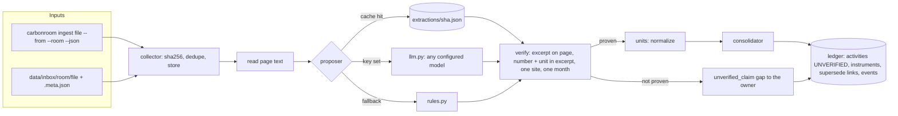
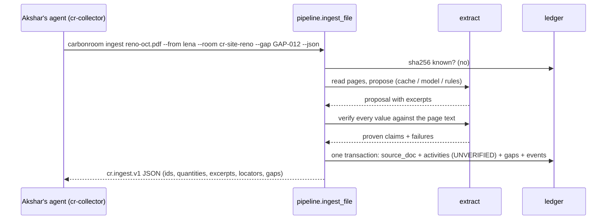

# Ingestion: collect → extract with proof → consolidate

**Owner:** Ujjwal · **Code:** `carbonroom/ingest/` · **Tests:** `tests/test_collector.py`, `tests/test_extract.py`,
`tests/test_units.py`, `tests/test_llm.py`, `tests/test_cli.py`

## Why

Bills arrive as messy files from many people in many rooms. The close needs them as ledger rows, and each row must
point to the exact line on the exact page of the exact file it came from. A model may read the document, but only
code decides what counts as proven.

## Architecture



One upload, end to end (Lena answers the missing-bill gap):



## Design

### Collector (`carbonroom/ingest/collector.py`)
- Identity is the sha256 of the bytes. A known hash is a `duplicate`: nothing is written except a
  `duplicate_skipped` event. Ingest is idempotent.
- Files under `data/seed/` are referenced in place. Anything else is copied to `data/store/<sha256><ext>`, so the
  evidence can't change or vanish after it is recorded.
- Hand-off with Akshar (recommended): call
  `carbonroom ingest <file> --from <handle> --room <room> --thread <id> --message <id> --gap <GAP-id> --json`.
  Or drop the file in `data/inbox/<room>/` with an optional `<file>.meta.json` sidecar and run
  `carbonroom ingest --watch`. CLI flags win over the sidecar; the room defaults to the folder name.
- Document kind comes from keyword rules first (`carbonroom.ingest.rules.classify`); the proposer's kind is used
  only when the rules say `other`.

### Extraction with proof (`carbonroom/ingest/extract.py`)
- Page text: pdfplumber for PDFs; `.txt`/`.md` split on form feeds. A scan, photo or corrupt PDF has no text,
  which becomes a gap, never a guess.
- Proposers (`--proposer` / `CR_PROPOSER`): `auto` = cache → model (if configured) → rules; `llm` = cache → model
  (error if none); `rules` = cache → rules. `--refresh-cache` skips the cache. Every proposal is saved to the cache
  with a label: `rules-v1`, `llm:<provider>:<model>`, and `cache:` is prefixed when it is reused. Proposal format:
  `cr.extraction.v1` (see `docs/EXPLAIN_ingestion.md`).
- Verification. A value is accepted only if:
  1. its excerpt (8+ characters) is found in the document text, ignoring whitespace and case
  2. the number is in that excerpt, and so is the unit
  3. the site evidence names exactly one known site, agreeing with the proposed site
  4. the period evidence names exactly one month, equal to the proposed month

  The ledger stores the full source line (not the model's wording), and code computes the locator
  (`page=2;line=6`).
- Site fallback: if the proposed site line names *no* known site (e.g. a model quotes "Customer: Brightwell
  Manufacturing"), code uses the document's own line, but only if the whole document names exactly one known site.
  Two sites, or a disagreement, means rejected.
- Extra fields per category, each verified the same way: diesel `delivery_ref`, `delivery_date`; cloud `pue`
  (required), `wue_l_per_kwh`, `cloud_region`; electricity/gas `meter_id`; REC `certificate_id`, `region`, `vintage`
  (all required). An unproven field becomes its own gap, while the proven quantity is still recorded.

### Units (`carbonroom/ingest/units.py`)
Electricity and cloud → kWh; natural gas → therm (Dth/MMBtu ×10); diesel → US gal (litres ÷ 3.785411784, rounded to
0.001); RECs → MWh. Gas volumes (ccf, m³) are refused, because they need the utility's heat content. The original
quantity, unit and conversion stay in `extra_json`.

### Consolidator (`carbonroom/ingest/consolidator.py`)
- One `activities` row per proven claim, always `UNVERIFIED`; instruments likewise.
- Two documents claiming the same thing (INV-204 vs INV-204B) are **both** stored. The checker raises the conflict.
- A proven "Replaces bill: X" marks X's document `superseded_by` the new one and records `replaces_activity_ids` on
  the new row. The old row's status is left for the checker (the "false done" reopen).
- Every failure becomes an `unverified_claim` gap for the site owner (or the uploader if no site was proven), with
  a dedupe key so re-runs never duplicate it.
- The document and all its rows are written in **one transaction**. The model call happens before it, outside
  the write lock.

### Failure modes

| Situation | Result |
| --- | --- |
| Same file again (any name) | `duplicate`, no change |
| Unreadable file (photo, corrupt PDF) | document kept (`other`), gap "no readable text" to the uploader |
| Model invents a number or excerpt | value rejected, `unverified_claim` gap; nothing stored as fact |
| Model down, rate-limited or timing out (auto mode) | rules proposer used, with a note in the result |
| Unit needs an assumption (ccf, kW) | claim rejected, gap |
| Corrected bill names a document we don't have | `replaces_unknown_doc` event; new rows still recorded |

### Output contract (`cr.ingest.v1`)
Per file: `file`, `sha256`, `status` (`new`/`duplicate`), `doc_id`, `kind`, `doc_ref`, `proposer`, `notes`, `site`,
`period`, `received_from`, `room`, `activities[]` (id, category, quantity, unit, status, excerpt, locator,
excerpt_sha256, replaces_activity_ids), `instruments[]`, `gaps[]`, `supersedes[]`. Example in `docs/HANDOFF.md`.

## Decisions

See `docs/DECISIONS.md`: locator by code; number + unit in excerpt; proposer order; site fallback; conflicts kept;
supersede without touching the old row; content-addressed store; inbox + CLI hand-off; units policy.

## Code map

| Name | Does |
| --- | --- |
| `carbonroom.ingest.collector.describe` | hash a file, merge CLI flags with its sidecar |
| `carbonroom.ingest.collector.store` | seed files in place, others copied to `data/store/` |
| `carbonroom.ingest.collector.iter_files` | supported files in a folder (skips sidecars, hidden, `_processed/`) |
| `carbonroom.ingest.extract.read_pages` | page text, `[]` if unreadable |
| `carbonroom.ingest.extract.propose` | cache → model → rules, saving every proposal |
| `carbonroom.ingest.extract.verify` | accept only what the document proves |
| `carbonroom.ingest.extract.find_excerpt` | locate an excerpt and compute the locator |
| `carbonroom.ingest.extract.site_named_in_document` | strict site fallback |
| `carbonroom.ingest.units.normalize` | canonical units, original kept |
| `carbonroom.ingest.rules.propose` | keyless label-pattern proposer |
| `carbonroom.ingest.consolidator.consolidate` | rows, supersede links, gaps |
| `carbonroom.ingest.pipeline.ingest_file` | one file end to end; returns `cr.ingest.v1` |
| `carbonroom.ingest.pipeline.watch` | poll `data/inbox/` |
| `carbonroom.ingest.evidence.evidence_status` | read-only re-check of one activity, for the checker |

## Commands

| Command | Flags |
| --- | --- |
| `carbonroom ingest PATH...` | `--from` sender handle, `--room`, `--thread`, `--message`, `--gap` (kept in the document's meta), `--proposer auto\|rules\|llm`, `--refresh-cache`, `--move-processed` (move inbox files to `_processed/`), `--json` |
| `carbonroom ingest --watch` | `--interval` seconds (default 3), `--keep` (leave files in place instead of moving them), `--json` |
| `carbonroom extract PATH...` | dry run, no ledger writes: `--proposer`, `--refresh-cache`, `--json` |

## Tests

`tests/test_collector.py` (duplicates by hash, inbox + sidecar, evidence store, unreadable files become gaps, kind
rules); `tests/test_extract.py` (excerpt finding, locators, numbers and periods, every rejection rule, site
fallback); `tests/test_units.py`; `tests/test_llm.py` (model proposals verified, cache, fallback);
`tests/test_seed_traps.py` (corrected bill, missing bill, conflicts, idempotent ingest); `tests/test_cli.py`
(`--json` output for agents, dry-run extract, `ledger verify` catches a changed file).

## How to use

```bash
uv run carbonroom ingest data/seed/later/2026-10_reno_electricity_ELB-RNO-2610.pdf --from lena --room cr-site-reno --gap GAP-012 --json
uv run carbonroom ingest --watch --json         # inbox mode
uv run carbonroom extract some-bill.pdf          # dry run: propose + verify, no ledger writes
uv run carbonroom ledger missing --period 2026-10
```
