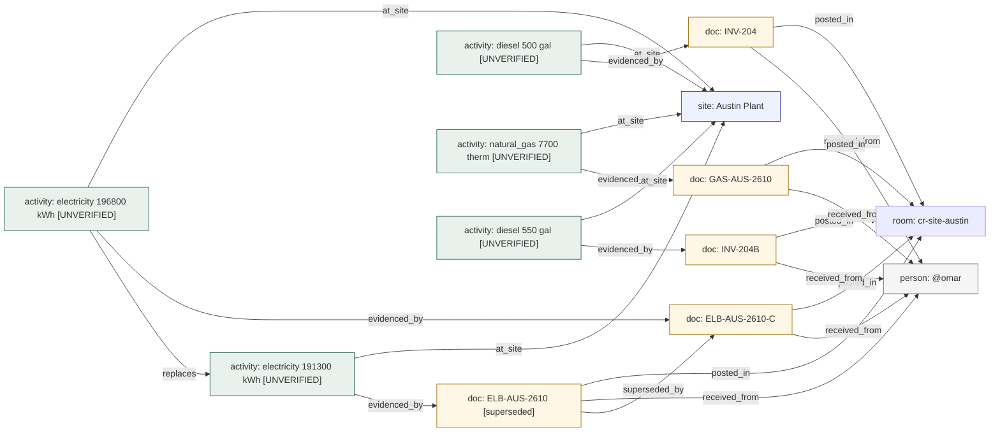

# Knowledge graph (ledger as a graph)

**Owner:** Ujjwal · **Code:** views in `contracts/schema.sql`, `carbonroom/ledger/graph.py` · **Tests:** `tests/test_graph.py`

## Why

The story the product tells: every number is linked to its site, month, source bill, sender, factor and
approver, and "where did this come from?" is one click away. An auditor picks a number and follows it to
the bill. The checker asks "this bill was replaced: which numbers depend on it?" Humans in chat ask a
specialist agent "why is this number what it is?" Those are graph questions.

The ledger is SQLite, a relational database. A knowledge graph is a way of modelling data (things plus
typed links between them), not a database product, so we model the ledger as a graph inside SQLite.
Nothing extra to install, and the demo still reproduces from a clone.

## Design

### Nodes and edges are live SQL views

`ledger_nodes(type, id, label, status, period_id)` and `ledger_edges(src_type, src_id, rel, dst_type, dst_id,
detail)` are **views** over the ledger tables. Nothing is stored twice, so the graph can never disagree with
the ledger, and new rows appear in the graph immediately.

| Edge (`rel`) | From → to | Comes from |
| --- | --- | --- |
| `evidenced_by` | activity / instrument → doc | `source_doc_id` (the locator rides on the edge) |
| `at_site`, `in_period` | activity → site, period | `site_id`, `period_id` |
| `superseded_by` | activity → activity, doc → doc, instrument → instrument | `superseded_by` |
| `replaces` | new activity → old activity | `extra_json.replaces_activity_ids` (corrected bills) |
| `received_from`, `posted_in` | doc → person, room | who sent it, from which room |
| `collected_in` | doc → run | `meta.run_id` (background batch runs) |
| `answers` | doc → gap | `meta.gap_id` (an upload that answers a gap) |
| `claimed_against` | instrument → site | REC claimed against a load |
| `of`, `uses_factor` | calculation → activity, factor | Richa's calculations |
| `about`, `about_site`, `owned_by`, `raised_in`, `resolved_by` | gap → doc / activity / instrument, site, person, room | gap columns + `refs_json` keys `source_doc_id`, `activity_id`, `activity_ids[]`, `instrument_id` |
| `owned_by`, `has_room` | site → person, room | site owner and room |
| `for_site` | expected → site | `expected_documents` |
| `for_period`, `by`, `approved_by` | approval → period, person; period → person | human approvals |

Node types: site, period, doc, activity, instrument, gap, calculation, factor, expected, approval, person,
room, run.

### Traversal is a recursive SQL query

`carbonroom.ledger.graph.walk` runs one `WITH RECURSIVE` query over `ledger_edges`, either **out** (what this
depends on) or **in** (what depends on this), up to a depth. Shared hubs (person, room, period, run, site)
are only walked *through* from the start node, so tracing one number doesn't pull in every other number from
the same month or person.

### Questions it answers

| Question | Function | Command |
| --- | --- | --- |
| Where did this number come from? | `carbonroom.ledger.graph.lineage` | `carbonroom ledger trace ACT-...` (or a `CALC-...`) |
| What does this bill / gap / person connect to? | `carbonroom.ledger.graph.walk` | `carbonroom ledger trace ELB-AUS-2610` |
| If this bill is wrong, what changes? | `carbonroom.ledger.graph.impact` | `carbonroom ledger impact ELB-AUS-2610` |
| Show the month (or one site) as a graph | `carbonroom.ledger.graph.period_graph` | `carbonroom ledger graph --period 2026-10 [--site austin]` |

References are what a human types: `ACT-…`, `DOC-…`, `GAP-…`, a printed bill number such as `ELB-AUS-2610`,
`@lena`, `austin`, `2026-10`, `cr-site-reno`, or explicit `type:id` (`carbonroom.ledger.graph.resolve`).

### Example (seed data + the corrected Austin bill)

`carbonroom seed`, then `carbonroom ingest data/seed/later/2026-10_austin_electricity_ELB-AUS-2610-C.pdf --from omar --room cr-site-austin`:

<!-- example:trace:start -->
```text
$ carbonroom ledger trace ACT-0739d5932d
191,300 kWh electricity · Austin Plant · 2026-10 · UNVERIFIED
  ← proven by page 1, line 10: "Total energy used this period: 191,300 kWh" (excerpt sha256 69191233c656…)
  ← in ELB-AUS-2610 (DOC-a0ac18b17109, file sha256 a0ac18b17109…, data/seed/docs/2026-10_austin_electricity_ELB-AUS-2610.pdf)
  ← sent by @omar in cr-site-austin
  ← extracted by cache:llm:nvidia:nvidia/nemotron-3-ultra-550b-a55b, then verified by code against the page text
  ⚠ that document was replaced by ELB-AUS-2610-C (DOC-1c5fa805b8af)
  ⚠ corrected value: ACT-0c96e79c12 = 196800 kWh (UNVERIFIED)
```
<!-- example:trace:end -->

<!-- example:impact:start -->
```text
$ carbonroom ledger impact ELB-AUS-2610
doc:DOC-a0ac18b17109  ELB-AUS-2610 [superseded]
  ← evidenced_by: activity:ACT-0739d5932d  electricity 191300 kWh [UNVERIFIED]
    ← replaces: activity:ACT-0c96e79c12  electricity 196800 kWh [UNVERIFIED]

Depends on doc:DOC-a0ac18b17109: 2 activities
```
<!-- example:impact:end -->

`carbonroom ledger graph --period 2026-10 --site austin` (GitHub renders this):

<!-- example:graph:start -->

<!-- example:graph:end -->

The three examples above are regenerated and compared by `tests/test_docs.py`, so they always match the code.

### When a graph database would be worth it

A separate graph database (e.g. Neo4j) pays off for unpredictable query shapes, unbounded depth, links invented
at runtime, or graph algorithms. A month-end close has none of these: its questions are short, fixed-shape walks.
A graph server would also break "clone and run." Everything goes through `carbonroom/ledger/`, so the same
edges could be mirrored into a graph database later without changing teammates' code.

## Decisions

See `docs/DECISIONS.md`: graph as SQL views (no duplicate storage, never stale); recursive-CTE traversal with hub
stopping; gap `refs_json` keys as the way to link gaps to rows; `graph_version` for view changes; no graph server.

## Code map

| Name | Does |
| --- | --- |
| `contracts/schema.sql` | `ledger_edges` and `ledger_nodes` views |
| `carbonroom.ledger.db.GRAPH_VERSION` | bump when the views change; `carbonroom.ledger.db.migrate` rebuilds them |
| `carbonroom.ledger.graph.resolve` | human reference → (type, id) |
| `carbonroom.ledger.graph.edges` | edges touching a node (or all) |
| `carbonroom.ledger.graph.walk` | recursive traversal, out or in |
| `carbonroom.ledger.graph.lineage` | full provenance of one number, as data + text |
| `carbonroom.ledger.graph.impact` | everything that depends on a node |
| `carbonroom.ledger.graph.period_graph` | one month (or one site's month) as a graph |
| `carbonroom.ledger.graph.to_mermaid` | Mermaid flowchart |
| `carbonroom.ledger.graph.to_json` | `cr.graph.v1` JSON (nodes + edges) |
| `carbonroom.ledger.graph.tree_lines` | indented text view of a walk |

## Tests

`tests/test_graph.py`: every activity has exactly its evidence, site and period edges, with the locator on the
evidence edge; the graph is live (new rows appear without a sync step); reference resolution; lineage of a
number through a corrected bill, a calculation and a gap, and of a CO2e number; unit conversion shown; impact of
a replaced bill (activities, calculation, gap); walks don't leak through hubs; gap refs, gap resolution, uploads
answering a gap and batch runs become edges; month and per-site graphs with consistent Mermaid/JSON; views rebuilt
when `graph_version` changes; the CLI commands. `tests/test_docs.py` regenerates the examples on this page.

## Commands

| Command | Flags |
| --- | --- |
| `carbonroom ledger trace REF` | `--depth` (default 6) for non-number nodes, `--json` |
| `carbonroom ledger impact REF` | `--depth` (default 4), `--json` |
| `carbonroom ledger graph` | `--period` (required), `--site`, `--format mermaid\|json`, `--depth` (default 3), `--out FILE` (`.md` gets a mermaid fence) |

## How to use

```bash
uv run carbonroom ledger trace ACT-0739d5932d          # where did this number come from?
uv run carbonroom ledger trace ELB-AUS-2610            # what does this bill connect to?
uv run carbonroom ledger impact ELB-AUS-2610           # if this bill is wrong, what changes?
uv run carbonroom ledger graph --period 2026-10 --site austin --out austin-october.md
```
