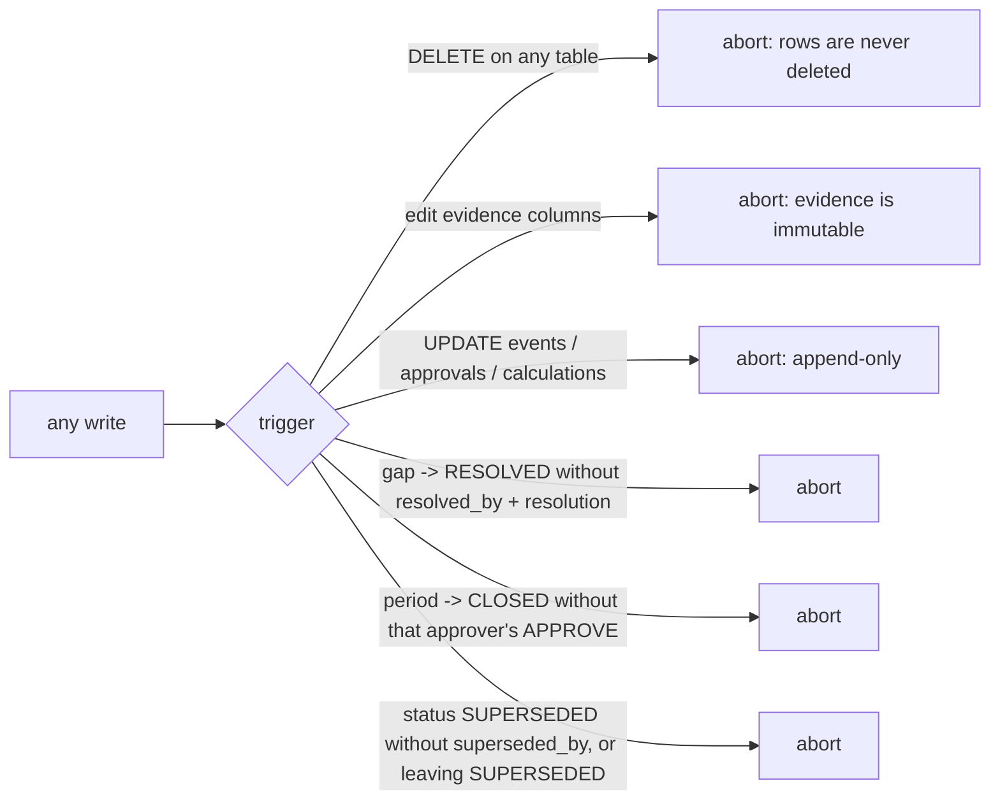

# Ledger: schema and access layer

**Owner:** Ujjwal · **Code:** `contracts/schema.sql`, `carbonroom/ledger/db.py` · **Tests:** `tests/test_ledger_db.py`

## Why

Every number Carbon Room reports has to be traceable to a bill, and nothing an agent does may quietly
change or erase evidence. The ledger is that single source of truth. Agents talk; the ledger remembers.

## Design

SQLite, "graph-lite": rows link to each other by id (activity → source document → site → period;
calculation → activity + factor; gap → site/period/rows). One file, `CR_DB_PATH` (default `./carbonroom.db`).

### Tables

| Table | Holds |
| --- | --- |
| `schema_meta` | schema version, for migrations |
| `sites` | facilities and the cloud line (`kind` = `facility`/`cloud`), owner handle, room, eGRID subregion, aliases |
| `periods` | months (`YYYY-MM`), `OPEN`/`CLOSED`, locked factor set, approver |
| `source_docs` | one row per unique file (by sha256), where it came from, printed doc number, `superseded_by` |
| `activities` | one row per proven claim: quantity, unit, source doc, verbatim excerpt, locator, excerpt hash, status |
| `emission_factors` | factor sets by version (Richa) |
| `calculations` | activity × factor results, append-only (Richa) |
| `instruments` | RECs/PPAs with the same proof as activities; `quality_flags` set by the checker |
| `gaps` | `GAP-###` problems with a named owner and room; closed only by a human with a written resolution |
| `approvals` | human APPROVE/REJECT decisions, append-only |
| `events` | append-only audit log of every write |
| `expected_documents` | which evidence each site must send (`monthly` / `as_delivered`), for missing-bill detection |

Kinds: gap kinds `missing_doc`, `conflict`, `stale_factor`, `outlier`, `excerpt_mismatch`, `unverified_claim`,
`rec_quality`. Document kinds `utility_bill`, `fuel_invoice`, `cloud_invoice`, `rec_certificate`, `other`.

### Conventions

- Quantities, factors and results are **decimal strings** (`"499.998"`), read with `Decimal`, never `float`
  (`carbonroom.ledger.db.dec_str` refuses floats). Same inputs, same totals.
- Ids are deterministic: `DOC-` + 12 hex chars of the file's sha256; `ACT-`/`INS-` + 10 hex chars of
  sha256(doc hash | category or certificate | excerpt hash). Re-ingesting creates nothing new.
- Rows come back as dicts; `*_json` columns are parsed and renamed (`extra`, `meta`, `refs`, `aliases`, `detail`).

### Guards (in the database, so they hold even against raw SQL)



Status rules (`carbonroom.ledger.db.ALLOWED_TRANSITIONS`): new activities are always `UNVERIFIED`; the checker
moves them to `VERIFIED` or `FLAGGED`; `VERIFIED → FLAGGED` is the "false done" reopen; `EXCLUDED` and `FLAGGED`
need a reason; `SUPERSEDED` is reached only through `carbonroom.ledger.db.supersede_activity` and is final.

Concurrency: WAL mode, 30 s busy timeout, writes inside `BEGIN IMMEDIATE` (`carbonroom.ledger.db.transaction`),
which joins an outer transaction if one is open. Several agents can share the file.

## Decisions

See `docs/DECISIONS.md` (Ujjwal): decimal strings; guards as triggers; additive columns listed in
`contracts/CHANGES.md`; `expected_documents`; cloud as a `sites` row; reset by removing the file, never SQL DELETE.

## Code map

| Name | Does |
| --- | --- |
| `carbonroom.ledger.db.connect` | open/create the ledger, apply schema + migrations |
| `carbonroom.ledger.db.migrate` | add any additive columns an older file lacks (never drops) |
| `carbonroom.ledger.db.add_activity` | insert one claim as `UNVERIFIED` (idempotent by id) |
| `carbonroom.ledger.db.set_activity_status` | move along `ALLOWED_TRANSITIONS`, logged |
| `carbonroom.ledger.db.supersede_activity` | old row → `SUPERSEDED`, pointing at the new one |
| `carbonroom.ledger.db.create_gap` | open `GAP-###` with owner/room defaults and a dedupe key |
| `carbonroom.ledger.db.resolve_gap` | close a gap with the human's handle and words |
| `carbonroom.ledger.db.close_period` | close a month (the database checks the approval) |
| `carbonroom.ledger.db.expected_but_missing` | monthly evidence with no live row yet |
| `carbonroom.ledger.db.export_period` | the whole month as `cr.ledger.v1` JSON |

The full function list is in `docs/HANDOFF.md`.

## Tests

`tests/test_ledger_db.py`: DELETE refused on every table; evidence immutable; transitions; supersede keeps both
rows and is final; floats refused; gap ids, dedupe and human-only resolution; close needs that approver's
APPROVE; events/approvals/calculations append-only; and a scan proving the code contains no SQL `DELETE FROM`.

## Commands

| Command | Flags |
| --- | --- |
| `carbonroom init` | creates an empty ledger at `--db` / `CR_DB_PATH` (global flags: `--db`, `--version`) |
| `carbonroom ledger show` | `--period` (required), `--site`, `--status` |
| `carbonroom ledger export` | `--period` (required), `--json` (output is always JSON), `--out FILE` |
| `carbonroom ledger gaps` | `--period`, `--status`, `--json` |
| `carbonroom ledger missing` | `--period` (required), `--json` |
| `carbonroom ledger events` | `--limit` (default 40), `--ref ID`, `--json` |
| `carbonroom ledger verify` | `--period`, `--verbose` / `-v`; exits 1 if any file or excerpt fails |

## How to use

```bash
uv run carbonroom init                         # empty ledger
uv run carbonroom ledger show --period 2026-10 # after seeding
uv run carbonroom ledger export --period 2026-10 --json
uv run carbonroom ledger verify                # re-hash every document, re-find every excerpt
uv run carbonroom ledger gaps --period 2026-10 --status OPEN
uv run carbonroom ledger events --limit 20     # the audit log
```
