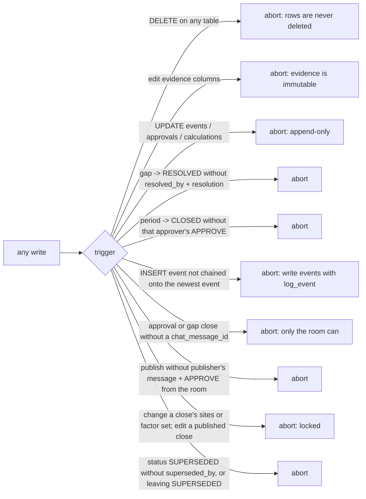

# Ledger: schema and access layer

**Owner:** Ujjwal · **Code:** `contracts/schema.sql`, `carbonroom/ledger/db.py` · **Tests:** `tests/test_ledger_db.py`

## Why

Every number Carbon Room reports has to be traceable to a bill, and nothing an agent does may quietly
change or erase evidence. The ledger is that single source of truth. Agents talk; the ledger remembers.

## Design

SQLite, modelled as a graph: rows link to each other by id (activity → source document → site → period;
calculation → activity + factor; gap → site/period/rows), and two read-only views expose those links as a
knowledge graph ([knowledge-graph.md](knowledge-graph.md)). One file, `CR_DB_PATH` (default `./carbonroom.db`).

### Tables

| Table | Holds |
| --- | --- |
| `schema_meta` | schema version, for migrations |
| `sites` | facilities and the cloud line (`kind` = `facility`/`cloud`), owner handle, room, eGRID subregion, aliases |
| `periods` | months (`YYYY-MM`), `OPEN`/`CLOSED`, locked factor set, approver |
| `source_docs` | one row per unique file (by sha256), where it came from, printed doc number, `superseded_by` |
| `activities` | one row per proven claim: quantity, unit, source doc, verbatim excerpt, locator, excerpt hash, status |
| `emission_factors` | factor sets by version (Richa) |
| `calculations` | activity × factor results, append-only (Richa) |
| `instruments` | RECs/PPAs with the same proof as activities; `quality_flags` set by the checker |
| `gaps` | `GAP-###` problems with a named owner and room (and the Watchdog `finding_id`); closed only by a human's reply in the room (`resolved_message_id`) |
| `approvals` | human APPROVE/REJECT decisions with the Switch `chat_message_id` they came from, append-only |
| `events` | append-only audit log of every write: who, what, about which id, from which chat message (`chat_message_id`); hash-chained (`prev_event_hash`, `event_hash`) |
| `expected_documents` | which evidence each site must send (`monthly` / `as_delivered`), for missing-bill detection |
| `closes` | one row per close of a month: locked boundary (sites) and factor set, phase, version, who published from which chat message |
| `ledger_edges` (view) | every link between rows, as a typed edge: the [knowledge graph](knowledge-graph.md) |
| `ledger_nodes` (view) | every row (plus people, rooms, runs) as a graph node with a label |

Kinds: gap kinds `missing_doc`, `conflict`, `stale_factor`, `outlier`, `excerpt_mismatch`, `unverified_claim`,
`rec_quality`. Document kinds `utility_bill`, `fuel_invoice`, `cloud_invoice`, `rec_certificate`, `other`.

### Conventions

- Quantities, factors and results are **decimal strings** (`"499.998"`), read with `Decimal`, never `float`
  (`carbonroom.ledger.db.dec_str` refuses floats). Same inputs, same totals.
- Ids are deterministic: `DOC-` + 12 hex chars of the file's sha256; `ACT-`/`INS-` + 10 hex chars of
  sha256(doc hash | category or certificate | excerpt hash). Re-ingesting creates nothing new.
- Rows come back as dicts; `*_json` columns are parsed and renamed (`extra`, `meta`, `refs`, `aliases`, `detail`).

### Guards (in the database, so they hold even against raw SQL)



Status rules (`carbonroom.ledger.db.ALLOWED_TRANSITIONS`): new activities are always `UNVERIFIED`; the checker
moves them to `VERIFIED` or `FLAGGED`; `VERIFIED → FLAGGED` is the "false done" reopen; `EXCLUDED` and `FLAGGED`
need a reason; `SUPERSEDED` is reached only through `carbonroom.ledger.db.supersede_activity` and is final.

### Audit chain (hashed)

Every event stores the hash of the event before it: `event_hash` = sha256 of the compact JSON array
`[prev_event_hash or "", at, actor, action, ref or "", chat_message_id or "", detail_json]` (`carbonroom.ledger.db.event_hash`).
Editing, removing or reordering any past event breaks every link after it, and
`carbonroom.ledger.db.verify_audit_chain` (run by `carbonroom ledger verify`) names the first broken event.
Re-hashing a forged event doesn't help: the next event still points at the old hash.

- `carbonroom.ledger.db.log_event` reads the newest hash and inserts inside one `BEGIN IMMEDIATE`, so
  agents writing at the same time line up instead of forking the chain. The `events_hash_chain` trigger
  refuses any insert (even raw SQL) that does not extend the newest event.
- A chain is only as strong as a copy of its head kept elsewhere: post `carbonroom.ledger.db.audit_head`
  in the room at each close step. Anyone holding that hash can later prove nothing before it changed.
- Older ledgers: `migrate` hashes events that have no hash yet, in id order, once (and logs
  `audit_chain_backfilled`). It never rewrites an event or an existing hash.

### Closes: locks, phases and the room gate

```mermaid
stateDiagram-v2
  [*] --> OPEN: start_close (sites + factor set locked)
  OPEN --> COLLECTING
  COLLECTING --> CALCULATING
  CALCULATING --> CHECKING
  CHECKING --> AWAITING_HUMANS
  CHECKING --> DRAFTED
  AWAITING_HUMANS --> RECHECKING
  RECHECKING --> AWAITING_HUMANS
  AWAITING_HUMANS --> DRAFTED
  RECHECKING --> DRAFTED
  DRAFTED --> RECHECKING
  DRAFTED --> AWAITING_HUMANS
  DRAFTED --> PUBLISHED: publish_close (publisher's message + APPROVE)
  PUBLISHED --> [*]: final; a correction is version N+1
```



- `carbonroom.ledger.db.start_close` writes `CLOSE-<month>-v<N>`. The boundary and the factor set are locked by
  triggers; while the close is open, the month's `factor_set_version` can't be changed to anything else.
- The phase lives in the ledger, so the orchestrator resumes from `carbonroom.ledger.db.get_open_close` after a
  crash. Moves follow `PHASE_TRANSITIONS`; repeating the current phase is a no-op.
- **Switch is load-bearing.** `record_approval` and `resolve_gap` need the Switch `chat_message_id` (the database
  refuses without one). `carbonroom.ledger.db.publish_close` needs the publisher's message and their `APPROVE` from
  the room, recorded after this close started, then closes the month. No CLI command approves, resolves or
  publishes, so outside the room you can only build an unverified draft.
- `carbonroom.ledger.db.expected_but_missing` only counts sites inside the boundary (the month's latest close),
  which is what "all collected" is measured against.

Concurrency: WAL mode, 30 s busy timeout, writes inside `BEGIN IMMEDIATE` (`carbonroom.ledger.db.transaction`),
which joins an outer transaction if one is open. Several agents can share the file.

## Decisions

See `docs/DECISIONS.md` (Ujjwal): decimal strings; guards as triggers; additive columns listed in
`contracts/CHANGES.md`; `expected_documents`; cloud as a `sites` row; reset by removing the file, never SQL DELETE;
the audit chain (hash per event, `chat_message_id` inside the hash, enforced by a trigger, backfilled once);
closes as rows with locked boundary and factor set; human actions need the room's message id.

## Code map

| Name | Does |
| --- | --- |
| `carbonroom.ledger.db.connect` | open/create the ledger, apply schema + migrations |
| `carbonroom.ledger.db.migrate` | add any additive columns an older file lacks (never drops) |
| `carbonroom.ledger.db.add_activity` | insert one claim as `UNVERIFIED` (idempotent by id) |
| `carbonroom.ledger.db.set_activity_status` | move along `ALLOWED_TRANSITIONS`, logged |
| `carbonroom.ledger.db.supersede_activity` | old row → `SUPERSEDED`, pointing at the new one |
| `carbonroom.ledger.db.create_gap` | open `GAP-###` with owner/room defaults and a dedupe key |
| `carbonroom.ledger.db.resolve_gap` | close a gap with the human's handle and words |
| `carbonroom.ledger.db.close_period` | close a month (the database checks the approval) |
| `carbonroom.ledger.db.expected_but_missing` | monthly evidence with no live row yet |
| `carbonroom.ledger.db.export_period` | the whole month as `cr.ledger.v1` JSON |
| `carbonroom.ledger.db.log_event` | append one event to the audit chain (under the write lock) |
| `carbonroom.ledger.db.verify_audit_chain` | recompute every link; name the first broken event |
| `carbonroom.ledger.db.audit_head` | the newest event's hash, to post in the room |
| `carbonroom.ledger.db.start_close` | open the next version of a month's close; lock sites + factor set |
| `carbonroom.ledger.db.set_close_phase` | move a close along `PHASE_TRANSITIONS`, logged |
| `carbonroom.ledger.db.publish_close` | the human publish gate (message id + APPROVE from the room) |

The full function list is in `docs/HANDOFF.md`.

## Tests

`tests/test_ledger_db.py`: DELETE refused on every table; evidence immutable; transitions; supersede keeps both
rows and is final; floats refused; gap ids, dedupe and human-only resolution; close needs that approver's
APPROVE; events/approvals/calculations append-only; and a scan proving the code contains no SQL `DELETE FROM`.

`tests/test_audit_chain.py`: every event links to the one before and verifies; the chat message id is inside
the hash; an edited, re-hashed or removed event is found where it happened; raw inserts that don't extend the
newest event are refused; four agents writing at once never fork the chain; an older ledger is hashed once and
keeps its append-only guard; `carbonroom ledger verify` reports the chain and exits 1 when it's broken.

`tests/test_closes.py`: start locks sites and factor set (and raw SQL can't change them); one open close per month
and resume finds it; phases follow the flow and repeat safely; a new version only after publishing, same factor
set; bad boundaries refused; missing evidence counted only inside the boundary; closes in the graph and export.
`tests/test_publish_needs_room.py`: approvals and gap closes refused without a chat message id (raw SQL too);
publish needs the publisher's message and their own APPROVE from the room since this close started; a published
close is final; the CLI has no approve, resolve or publish command.

## Commands

| Command | Flags |
| --- | --- |
| `carbonroom init` | creates an empty ledger at `--db` / `CR_DB_PATH` (global flags: `--db`, `--version`) |
| `carbonroom ledger show` | `--period` (required), `--site`, `--status` |
| `carbonroom ledger export` | `--period` (required), `--json` (output is always JSON), `--out FILE` |
| `carbonroom ledger gaps` | `--period`, `--status`, `--json` |
| `carbonroom ledger missing` | `--period` (required), `--json` |
| `carbonroom ledger events` | `--limit` (default 40), `--ref ID`, `--json` |
| `carbonroom ledger closes` | `--period`, `--json` |
| `carbonroom ledger verify` | `--period`, `--verbose` / `-v`; also checks the audit chain; exits 1 if any file, excerpt or chain link fails |

## How to use

```bash
uv run carbonroom init                         # empty ledger
uv run carbonroom ledger show --period 2026-10 # after seeding
uv run carbonroom ledger export --period 2026-10 --json
uv run carbonroom ledger verify                # re-hash every document, re-find every excerpt, check the audit chain
uv run carbonroom ledger gaps --period 2026-10 --status OPEN
uv run carbonroom ledger events --limit 20     # the audit log
```
