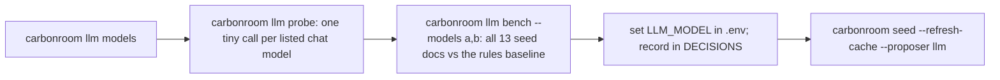

# Model provider layer

**Owner:** Ujjwal · **Code:** `carbonroom/llm.py` · **Tests:** `tests/test_llm.py`

## Why

A model reads documents and *proposes* fields. It never does arithmetic and never writes to the ledger directly:
`carbonroom/ingest/extract.py` verifies every proposed value against the page text. Because of that, the model is
swappable, and it should be. Free hosted models get retired (Llama 3.3 70B returned HTTP 410 on NVIDIA on
2026-11-03), and different teams have different keys.

## Design

- One module, `carbonroom/llm.py`. Every call goes through the standard `openai` client with a provider preset:

  | `LLM_PROVIDER` | Base URL | Key |
  | --- | --- | --- |
  | `nvidia` (default) | `https://integrate.api.nvidia.com/v1` (`NVIDIA_BASE_URL` overrides) | `NVIDIA_API_KEY` |
  | `anthropic` | `https://api.anthropic.com/v1/` (`CR_ANTHROPIC_BASE_URL` overrides) | `ANTHROPIC_API_KEY` |

- **No default model.** `LLM_MODEL` must be set. Without it, `carbonroom.llm.is_configured` is false and `auto`
  mode quietly uses the cache, then rules.
- Throttle: `CR_LLM_RPM` (default 35/min; NVIDIA's free tier allows about 40). Timeout: `CR_LLM_TIMEOUT` (45 s).
  Tries: `CR_LLM_ATTEMPTS` (3). 429/5xx/timeouts are retried, honouring Retry-After. 401/403/404/410 are not
  retried (`carbonroom.llm.UNAVAILABLE_STATUS`).
- NVIDIA calls send `temperature=0`. Anthropic calls send no temperature or `response_format`, because the
  compatibility layer rejects them on recent models.
- Replies are parsed with `carbonroom.llm.parse_json_object`, which tolerates code fences and `<think>` blocks.

### Choosing a model



Current choice: `nvidia/nemotron-3-ultra-550b-a55b` (13/13 exact, 0 rejected). Backup:
`nvidia/nemotron-3.5-bolt-e4b` (13/13).

## Decisions

See `docs/DECISIONS.md`: no default model; probe and bench results; timeouts/attempts; cloud-site prompt fix;
`CR_ANTHROPIC_BASE_URL` instead of `ANTHROPIC_BASE_URL`.

## Code map

| Name | Does |
| --- | --- |
| `carbonroom.llm.provider` | resolve provider, base URL, key, model from the environment |
| `carbonroom.llm.chat` | throttled, retried chat completion |
| `carbonroom.llm.chat_json` | `chat` + JSON parsing |
| `carbonroom.llm.probe` | one tiny call: does this model answer, does it return JSON? |
| `carbonroom.llm.list_models` | GET /models |
| `carbonroom.llm.looks_like_chat_model` | hide embedding/safety/OCR models from lists |
| `carbonroom.ingest.extract.llm_propose` | the extraction prompt (`cr.extraction.v1`) |

## Tests

`tests/test_llm.py` (fully mocked, no network): proven LLM values are stored, invented ones become gaps; cache works
with no key; an edited cache still fails verification; auto mode falls back to rules; no model means not
configured; retired/missing models are not retried; Retry-After honoured; Anthropic gets no temperature; probe and
bench (early stop on unavailable or repeatedly timing-out models).

## Commands

| Command | Flags |
| --- | --- |
| `carbonroom llm models` | `--grep REGEX`, `--all` (include embedding/safety/OCR models) |
| `carbonroom llm probe` | `--models a,b` (default: listed chat models), `--grep REGEX`, `--all`, `--limit` (default 25) |
| `carbonroom llm bench` | `--models a,b`, `--verbose` / `-v` |

## How to use

```bash
uv run carbonroom llm models --grep "nemotron|qwen"
uv run carbonroom llm probe
uv run carbonroom llm bench --models nvidia/nemotron-3-ultra-550b-a55b,nvidia/nemotron-3.5-bolt-e4b -v
```
