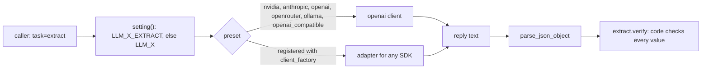
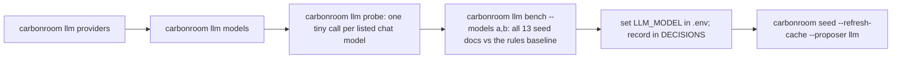
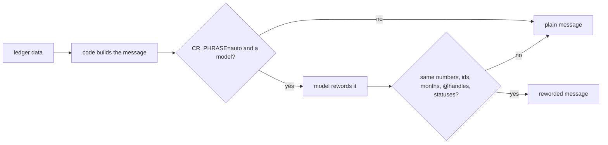

# Model provider layer

**Owner:** Ujjwal · **Code:** `carbonroom/llm.py` · **Tests:** `tests/test_llm.py`

## Why

A model reads documents and *proposes* fields. It never does arithmetic and never writes to the ledger directly:
`carbonroom/ingest/extract.py` verifies every proposed value against the page text. Because of that, any model
can be plugged in, and it must be possible to swap one: free hosted models get retired (Llama 3.3 70B returned
HTTP 410 on NVIDIA on 2026-11-03), teammates have different keys, and the team wants agents that work with any
model.

## Design

Every call goes through `carbonroom.llm.chat` with a **provider preset**. Any server that speaks the OpenAI
chat-completions API works by settings alone:

| `LLM_PROVIDER` | Base URL | Key | Temperature sent |
| --- | --- | --- | --- |
| `nvidia` (default) | `https://integrate.api.nvidia.com/v1` (`NVIDIA_BASE_URL` overrides) | `NVIDIA_API_KEY` | 0 |
| `anthropic` | `https://api.anthropic.com/v1/` (`CR_ANTHROPIC_BASE_URL` overrides) | `ANTHROPIC_API_KEY` | none (rejected) |
| `openai` | `https://api.openai.com/v1` | `OPENAI_API_KEY` | none (reasoning models reject it) |
| `openrouter` | `https://openrouter.ai/api/v1` | `OPENROUTER_API_KEY` | 0 |
| `ollama` | `http://localhost:11434/v1` | none (local) | 0 |
| `openai_compatible` | `LLM_BASE_URL` (required) | `LLM_API_KEY` (optional) | 0 |

Settings are resolved by `carbonroom.llm.setting`, so each one can be set per **task**:

```text
LLM_<FIELD>_<TASK>   if set (e.g. LLM_MODEL_EXTRACT, LLM_PROVIDER_EXTRACT)
LLM_<FIELD>          otherwise
FIELD = PROVIDER | MODEL | BASE_URL | API_KEY | TEMPERATURE      task "extract" = document extraction
```

`LLM_BASE_URL` / `LLM_API_KEY` override any preset (e.g. a company proxy); `LLM_TEMPERATURE=none` never sends
temperature. Teammates' agents can call `carbonroom.llm.chat(messages, task="report")` and get their own model
via `LLM_MODEL_REPORT`, without code changes.

A provider that does **not** speak the OpenAI API plugs in with `carbonroom.llm.register_provider(name,
client_factory=...)`: the factory wraps any SDK in an object with `.chat.completions.create(**kwargs)`.
`tests/test_llm_providers.py` drives a full extraction through such a homegrown adapter.



- **No default model.** `LLM_MODEL` (or `LLM_MODEL_<TASK>`) must be set. Without it,
  `carbonroom.llm.is_configured` is false and `auto` mode quietly uses the cache, then rules.
- Throttle `CR_LLM_RPM` (default 35/min), timeout `CR_LLM_TIMEOUT` (45 s), tries `CR_LLM_ATTEMPTS` (3).
  429/5xx/timeouts are retried, honouring Retry-After. 401/403/404/410 are not
  (`carbonroom.llm.UNAVAILABLE_STATUS`). A plugged-in client that raises anything becomes an `LLMError`, so
  `auto` mode falls back to rules instead of crashing.
- Replies are parsed with `carbonroom.llm.parse_json_object` (tolerates code fences and `<think>` blocks).
- Cache labels record the producer: `llm:<provider>:<model>`.

### Choosing a model



Current choice: `nvidia/nemotron-3-ultra-550b-a55b` (13/13 exact, 0 rejected). Backup:
`nvidia/nemotron-3.5-bolt-e4b` (13/13). To try another vendor: `carbonroom llm bench --provider openrouter --models ...`.

### Extract and phrase only

The architecture's "Model adapter: extract, phrase only". The model never does arithmetic or decides a status.

- **extract** (task `extract`): proposes fields from a document; code keeps them only if the excerpt is on the page.
- **phrase** (task `phrase`, `carbonroom.llm.phrase`): rewords a message that code built from ledger data, for
  people, optionally answering their question. The reworded text is used only if it keeps exactly the same numbers
  (commas ignored), ids (`GAP-012`, `INV-204B`, `CLOSE-2026-10-v1`), months, `@handles` and status words
  (`carbonroom.llm.facts_in`); otherwise, or on any model error, the plain message is used and `reason` says why.
  Off by default (`CR_PHRASE=off`): the plain messages are already readable and the demo stays repeatable. Turn it
  on with `CR_PHRASE=auto`; give it a fast model with `LLM_MODEL_PHRASE`.



### Budgets: a token cap per agent per close

`carbonroom.budgets.scope(conn, close_id, agent)` charges every model call inside it (including the batch run's
worker threads, which inherit the scope) to that agent for that close. Each call appends an `llm_usage` event
(task, model, tokens) to the ledger's audit chain, so the tally survives restarts and is shared by every process.
At `CR_BUDGET_WARN` (0.8) of `CR_BUDGET_TOKENS` (200,000) it appends `budget_warning`; at the cap it appends
`budget_exhausted` and further calls raise `carbonroom.llm.BudgetExceeded`, which callers treat like "no model":
extraction falls back to the cache and rules, phrasing to the plain message. Nothing loops or runs up a bill.
Tokens come from the provider's `usage`; if it reports none, about 4 characters per token.
`carbonroom llm budget --close CLOSE-2026-10-v1` shows the spend.

### Replay mode

`CR_PROPOSER=replay` (or `--proposer replay`) reads only the committed extraction cache: no model, no rules. A
document that isn't in the cache gets nothing extracted (a gap says so) rather than a guess. With the cache in the
repo, judges reproduce the seed exactly without an API key.

## Decisions

See `docs/DECISIONS.md`: model-agnostic presets + per-task settings + adapters; no default model; probe and bench
results; timeouts/attempts; cloud-site prompt fix; `CR_ANTHROPIC_BASE_URL` instead of `ANTHROPIC_BASE_URL`;
phrase guarded by "same facts" (off by default); budgets kept in the audit chain; replay mode.

## Code map

| Name | Does |
| --- | --- |
| `carbonroom.llm.provider` | resolve provider, base URL, key, model, temperature (per task) |
| `carbonroom.llm.setting` | `LLM_<FIELD>_<TASK>`, else `LLM_<FIELD>` |
| `carbonroom.llm.register_provider` | add a preset, or plug in any SDK via `client_factory` |
| `carbonroom.llm.describe_providers` | presets, which keys are set, which is active |
| `carbonroom.llm.chat` | throttled, retried chat completion |
| `carbonroom.llm.chat_json` | `chat` + JSON parsing |
| `carbonroom.llm.probe` | one tiny call: does this model answer, does it return JSON? |
| `carbonroom.llm.list_models` | GET /models |
| `carbonroom.llm.looks_like_chat_model` | hide embedding/safety/OCR models from lists |
| `carbonroom.ingest.extract.llm_propose` | the extraction prompt (`cr.extraction.v1`) |
| `carbonroom.llm.phrase` | reword a ledger message; refused if any fact changes |
| `carbonroom.llm.facts_in` | the numbers, ids, months, @handles and statuses a rewording must keep |
| `carbonroom.llm.Budget` | the cap, the warning line, refusing calls at the cap |
| `carbonroom.llm.budget_scope` | charge calls in this block (and threads that inherit it) to a budget |
| `carbonroom.budgets.scope` | a budget for one agent on one close, tallied in the ledger |
| `carbonroom.budgets.report` | spend per agent for a close |

## Tests

`tests/test_llm.py` (fully mocked, no network): proven LLM values are stored, invented ones become gaps; cache works
with no key; an edited cache still fails verification; auto mode falls back to rules; no model means not
configured; retired/missing models are not retried; Retry-After honoured; Anthropic gets no temperature; probe and
bench (early stop on unavailable or repeatedly timing-out models). `tests/test_llm_providers.py`: every preset's URL,
key and temperature; local Ollama needs no key; any OpenAI-compatible server; generic and per-task overrides; a
homegrown non-OpenAI SDK plugged in with `register_provider` drives a real extraction; a failing plug-in falls back to
rules; `llm providers` and `--provider`. `tests/test_model_adapter.py`: phrasing is off unless asked; a faithful
rewording is used; one that changes a number, drops an id, changes a status, invents a total, shifts the month or
names another owner is refused; a failing or missing model keeps the plain message; phrase has its own model
setting; a budget warns once then stops calls; the tally lives in the ledger and survives a restart; a spent budget
makes extraction fall back to rules; the batch run's worker threads charge the same budget; replay reproduces the
seed from the cache and never guesses an uncached document.

## Commands

| Command | Flags |
| --- | --- |
| `carbonroom llm providers` | `--json`; `*` marks the active provider |
| `carbonroom llm models` | `--provider NAME`, `--grep REGEX`, `--all` (include embedding/safety/OCR models) |
| `carbonroom llm probe` | `--provider NAME`, `--models a,b` (default: listed chat models), `--grep REGEX`, `--all`, `--limit` (default 25) |
| `carbonroom llm bench` | `--provider NAME`, `--models a,b`, `--verbose` / `-v` |
| `carbonroom llm budget` | `--close CLOSE-...` (required), `--json` |

`--provider` switches the provider for that one run (same as setting `LLM_PROVIDER`).

## How to use

```bash
uv run carbonroom llm providers
uv run carbonroom llm models --grep "nemotron|qwen"
uv run carbonroom llm probe
uv run carbonroom llm bench --models nvidia/nemotron-3-ultra-550b-a55b,nvidia/nemotron-3.5-bolt-e4b -v
```
