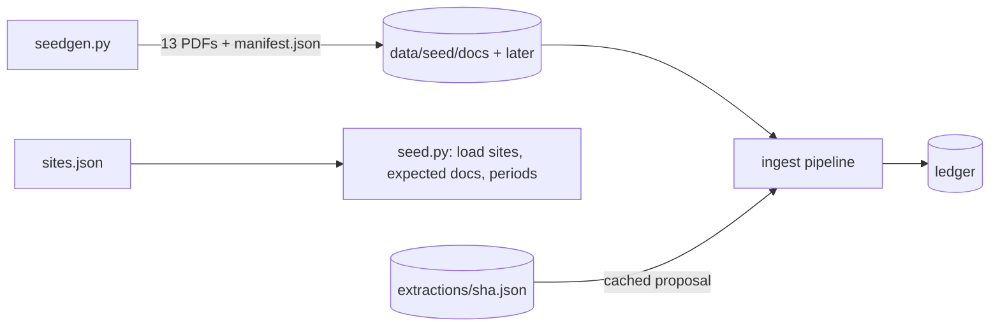

# Seed data with demo traps

**Owner:** Ujjwal · **Code:** `carbonroom/ingest/seedgen.py`, `carbonroom/ingest/seed.py` · **Data:** `data/seed/`
· **Tests:** `tests/test_seed_traps.py`

## Why

The demo needs a believable company whose month-end close contains every problem Carbon Room is built to
catch, and judges must be able to reproduce it from a clone with no API key. Everything is fictional.

## Design

- **Company:** Brightwell Manufacturing (fictional), with Austin Plant (`austin`, owner `omar`), Reno Office
  (`reno`, owner `lena`) and the purchased cloud line Nimbus Cloud us-east-va (`nimbus-cloud`, owner `dev`).
  Defined in `data/seed/sites.json`, including which documents each site must send.
- **Documents:** 13 text PDFs generated by code. 11 are in `data/seed/docs/` and are loaded by `carbonroom seed`.
  2 are held back in `data/seed/later/` for the live demo: the missing Reno October bill, and the corrected
  Austin October bill. The document-by-trap table is in `data/seed/README.md`.
- **Traps seeded** (contract 5.6): 1 missing bill, 2 conflicting diesel invoices for one delivery, 4 false done
  (corrected bill), 5 gas outlier (+60.4%), 6 data-centre line (IT kWh, PUE, WUE on page 2) plus a low-quality REC.
  Trap 3 (stale factor) lives in Richa's factor sets, not in a document.
- **Reproducible bytes:** reportlab `invariant` mode, so regenerating gives identical files and hashes.
- **Keyless:** `data/seed/extractions/<sha256>.json` holds a proposal for every seed document, each labelled with
  what produced it. The committed set is labelled `llm:nvidia:nvidia/nemotron-3-ultra-550b-a55b` (re-saved after
  `carbonroom llm bench` scored that model 13/13). Every cached proposal is re-verified against its PDF on every run.



After `carbonroom seed`: **11 documents, 10 activities** (all `UNVERIFIED`), 1 REC instrument, 0 gaps, and
"Expected but missing: Reno Office electricity" for 2026-10.

## Decisions

See `docs/DECISIONS.md`: invariant PDFs; diesel is `as_delivered`; cloud as a `cloud` site; September loaded
`OPEN`/`UNVERIFIED`; cache re-saved with Nemotron 3 Ultra.

## Code map

| Name | Does |
| --- | --- |
| `carbonroom.ingest.seedgen.seed_documents` | the 13 document specs (text, folder, traps) |
| `carbonroom.ingest.seedgen.generate` | write the PDFs and `data/seed/manifest.json` |
| `carbonroom.ingest.seed.load_sites` | sites, expected documents, periods from `data/seed/sites.json` |
| `carbonroom.ingest.seed.run_seed` | reset the ledger file and ingest every `docs/` entry of the manifest |

## Tests

`tests/test_seed_traps.py`: every activity is `UNVERIFIED` and provable (file hash, excerpt on its page, excerpt
hash); one test per trap; unit normalization keeps the original; ingest is idempotent; seed is reproducible; PDFs
are deterministic; every page says FICTIONAL; the committed cache covers every seed document.

## Commands

| Command | Flags |
| --- | --- |
| `carbonroom seed` | `--regenerate-docs` (rebuild PDFs first), `--with-later` (also load held-back docs), `--proposer auto\|rules\|llm`, `--refresh-cache` (ignore cached extractions), `--json` |

## How to use

```bash
uv run carbonroom seed                       # reset + load (uses the cache; no key needed)
uv run carbonroom seed --regenerate-docs     # rebuild the PDFs first (same bytes)
uv run carbonroom seed --refresh-cache --proposer llm          # re-extract with the configured model
uv run carbonroom extract data/seed/later/*.pdf --proposer llm --refresh-cache   # held-back docs, no ledger writes
```
